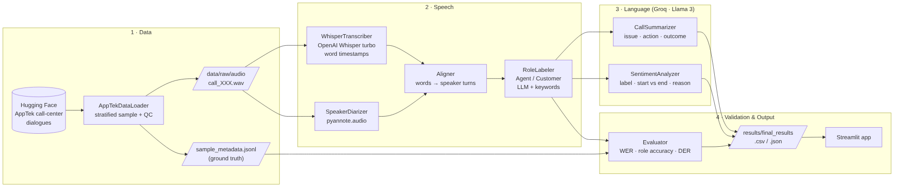
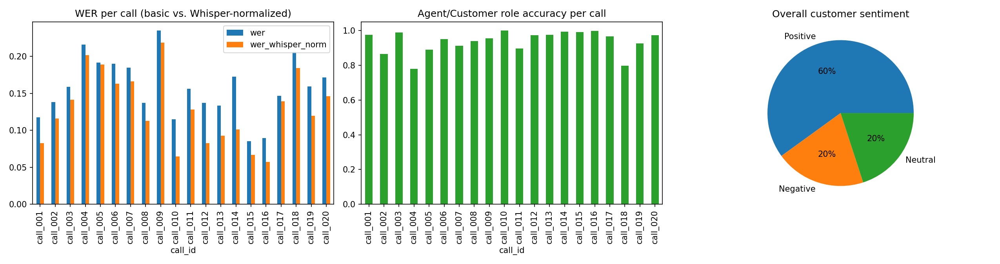
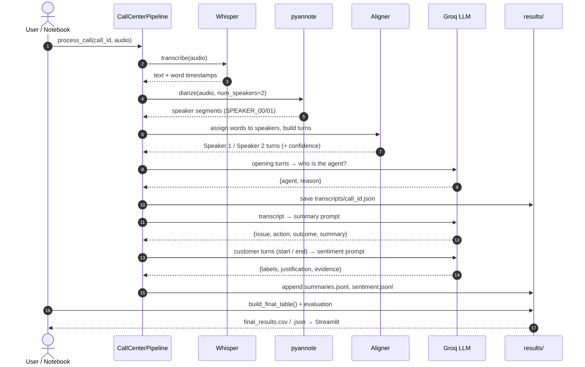

# 📞 Call Center AI — Agent Performance Analysis

End-to-end, reproducible pipeline that analyses customer-service phone calls:
**dataset research → transcription → speaker separation (Customer / Agent) → call summaries → customer sentiment → results & demo.**

Built for the Maharah GDP Trainee Assessment.



---

## 1. Objective
For each call, produce: segmented transcript with **Customer / Agent** turns, a short **summary** (issue, agent action, outcome), and the **customer sentiment** (label, justification, start vs. end of call). Every step is checked against human ground truth where possible.

## 2. Data source
| | |
|---|---|
| **Dataset** | [AppTek Call Center Dialogues](https://huggingface.co/datasets/apptek-com/apptek_callcenter_dialogues) (`diarization` config) |
| **Content** | 873 English agent ↔ customer calls, 14 accent groups, manual verbatim transcripts with `agent` / `customer` labels |
| **License** | CC BY-SA 4.0 — © AppTek. Derived transcripts in `results/` are shared under the same license |
| **Nature of data** | ⚠️ **Role-played** calls (not real customers). No private recordings are used |
| **Sample used** | 20 calls, stratified across accents, ≤ 8 min each, fixed seed 42 (`src/config.py`) |

Why this dataset: see `research/AI_Call_Center_Datasets_Benchmark.xlsx` (11 datasets + 9 papers/writeups compared, weighted selection criteria). Audio is **not** committed to the repo (size); notebook 01 downloads it.

## 3. Setup

### Google Colab (recommended: free T4 GPU)
1. Put this repository folder in Google Drive at `MyDrive/call-center-ai` (or clone it there).
2. In Colab: **Runtime → Change runtime type → T4 GPU**.
3. Add two secrets with the 🔑 icon (left sidebar), and enable notebook access:
   - `HF_TOKEN`: a Hugging Face *read* token ([create one](https://huggingface.co/settings/tokens))
   - `GROQ_API_KEY`: a free key from [console.groq.com](https://console.groq.com/keys)
4. While logged in to Hugging Face, accept the model terms once:
   [speaker-diarization-community-1](https://huggingface.co/pyannote/speaker-diarization-community-1) ·
   [speaker-diarization-3.1](https://huggingface.co/pyannote/speaker-diarization-3.1) ·
   [segmentation-3.0](https://huggingface.co/pyannote/segmentation-3.0)

### Local
```bash
python -m venv .venv && source .venv/bin/activate
pip install -r requirements.txt
export HF_TOKEN=...  GROQ_API_KEY=...      # never commit keys (.env is git-ignored)
```

## 4. How to run
Run the notebooks in order. Each one saves its output to `results/` and skips calls already done, so it is safe to re-run.

| Notebook | Task | Output |
|---|---|---|
| `01_dataset_selection_and_quality` | Tasks 1–3: catalog, sample, download, quality checks | `data/raw/`, `results/data_quality_report.csv` |
| `02_transcription_and_speaker_segmentation` | Task 4: Whisper + diarization + roles + WER / role accuracy | `results/transcripts/*.json`, `results/evaluation.csv` |
| `03_call_summarization` | Task 5 | `results/summaries.jsonl` |
| `04_sentiment_analysis` | Task 6 | `results/sentiment.jsonl` |
| `05_results_and_validation` | Final table, metrics, manual review | `results/final_results.csv/.json`, `results/manual_review.csv` |
| `06_streamlit_demo_colab` | Bonus demo | public demo link |

Streamlit demo locally (results viewer needs no GPU): `streamlit run app.py`
Unit tests (no GPU / keys needed): `python -m pytest -q`

## 5. Method
1. **Transcription** — OpenAI Whisper `turbo` (large-v3-turbo), English, word-level timestamps, `condition_on_previous_text=False` to reduce repetition on long audio.
2. **Speaker separation** — pyannote.audio diarization with `num_speakers=2`. Each Whisper word is assigned to the speaker segment it overlaps most; consecutive words become turns labelled **Speaker 1 / Speaker 2** in order of appearance.
3. **Customer / Agent labels — how they are identified**
   - An LLM on Groq (auto-selected, e.g. gpt-oss-120b; temperature 0) reads the first 12 turns and names the agent, with a one-line reason.
   - A keyword heuristic is the fallback and cross-check: agent phrases (*"thank you for calling", "how can I help", "let me check"*) vs. customer phrases (*"I have a problem", "my account"*).
   - If both fail, the first speaker is assumed to be the agent. The method and reason are saved for every call.
4. **Unclear audio** — turns with mean Whisper word probability < 0.5 are flagged `low_confidence` and listed in the notes.
5. **Summaries** — LLM prompt that must use only transcript facts and returns `customer_issue`, `agent_action`, `outcome`, `summary` (JSON); "Not stated" when missing.
6. **Sentiment** — customer turns only; LLM returns overall / start / end label (Negative · Neutral · Positive), justification, evidence quotes and confidence. The trend is computed in code from start vs. end. Prompt v2 adds explicit definitions (overall = *dominant* emotion across the call; routine politeness such as "thanks" = Neutral) after validation showed that prompt v1 labelled identical patterns inconsistently (v1 results kept in `results/sentiment_v1.jsonl`; v2 changed 4/20 overall labels).
7. **Validation**
   - Against the dataset's human labels: **WER** (jiwer; basic normalization and Whisper's official `EnglishTextNormalizer`), **role accuracy** (share of speech time with the correct Agent/Customer label), **DER** (pyannote.metrics).
   - **Number-grounding check** for summaries: every number in a summary must appear in the transcript (in any format).
   - **Manual review** of the 6 hardest calls (customer starts Negative, ends Positive): the author labelled sentiment independently and checked summaries and roles (`results/manual_review.csv`).

## 6. Results



| Area | Metric | Value |
|---|---|---|
| Data | Calls processed / audio | 20 calls · 137 min · 14 accent groups · 11 domains |
| Data quality | Checks (format, roles, empty segments, duration) | 0 problems; all 16 kHz mono |
| Transcription | Corpus WER, basic / Whisper normalizer | 15.9% / **13.3%** |
| Speaker separation | Mean role accuracy · mean DER | **93.7%** · 18.7% |
| Roles | Agent/Customer correct at call level | 20 / 20 (LLM decided all 20) |
| Summaries | Hallucinated numbers · manual review | **0** / 20 · 6 / 6 correct |
| Sentiment | Overall distribution | Positive 12 · Negative 4 · Neutral 4 |
| Sentiment | Human agreement on the 6 hardest calls (start / end / overall) | 4/6 · **6/6** · 3/6 |
| Roles (manual) | Correct in manual review | 5 / 6 (call_004: short customer replies merged into agent turns) |

**Key findings**
- Most remaining WER comes from proper nouns ("Fox Courier" → "Fox Korea") and acoustic confusions; 2.6 points of the basic WER were only formatting (numbers as digits vs. words). British accents were hardest in this sample.
- Role labelling by the LLM never swapped Agent and Customer; role errors come from diarization absorbing short back-channels ("yeah", "okay").
- Sentiment: model and human agree on how calls end; all 3 overall disagreements go the same way — the model weights *how long* the customer was frustrated, the human weights *whether the problem was solved*. The human also used tone of voice, which a text-only model cannot hear.

Per-call output: `results/final_results.csv` with `call_id · speakers · transcript · summary · sentiment · notes`.

## 7. Limitations
- **Role-played English calls**: cleaner than real traffic; results may be optimistic. Arabic / Saudi calls would need a different or fine-tuned model (see SADA in the survey).
- Diarization errors on overlapping speech or very short turns can produce wrong speaker turns.
- Whisper can hallucinate on long silences; flagged turns should be checked manually.
- LLM outputs are probabilistic; temperature 0 and JSON output reduce, but do not remove, errors. Validated on a small manual sample only.
- Groq free-tier rate limits: the code waits and retries, and switches to the next available model if a model is retired or its daily limit is reached.
- 20-call sample: metrics are indicative, not statistically strong. Calls were limited to ≤ 8 minutes (roughly the shortest 25% of the dataset, median 10.3 min) for run time on a free Colab GPU; longer calls may have more speaker changes and lower accuracy.
- Sentiment is text-only (no tone of voice); routine politeness can still be read as Positive; the model's self-reported confidence (0.86–0.96) is not calibrated; 20% of overall labels changed between prompt versions.
- The manual review covers 6 deliberately difficult calls with one reviewer (the author), so it describes borderline behaviour, not overall accuracy.
- The human reference transcripts are not perfect (small omissions found while listening), so part of the measured WER may be reference error.

## 8. Repository structure
```
call-center-ai/
├── notebooks/            01 → 06, one notebook per task
├── src/                  reusable classes (OOP)
│   ├── config.py         paths, models, settings, secrets
│   ├── data_loader.py    AppTekDataLoader, quality_report
│   ├── transcriber.py    WhisperTranscriber
│   ├── diarizer.py       SpeakerDiarizer (pyannote)
│   ├── aligner.py        words → speaker turns
│   ├── role_labeler.py   RoleLabeler (Agent / Customer)
│   ├── llm.py            GroqLLM (JSON, retries, rate limits)
│   ├── summarizer.py     CallSummarizer
│   ├── sentiment.py      SentimentAnalyzer
│   ├── evaluator.py      WER, role accuracy, DER
│   └── pipeline.py       CallCenterPipeline, final results table
├── app.py                Streamlit demo
├── tests/                offline unit tests
├── docs/                 architecture + sequence diagrams, figures
├── research/             dataset & paper survey (Excel)
├── results/              transcripts, summaries, sentiment, evaluation, final table
├── data/                 downloaded audio (git-ignored)
└── requirements.txt
```

## 9. Tools & models
OpenAI Whisper (turbo) · pyannote.audio (speaker-diarization-community-1 / 3.1) · Groq API (model auto-selected from a preference list: gpt-oss-120b → llama-3.3-70b → gpt-oss-20b …) · jiwer · pandas · Streamlit · Hugging Face Hub.

## 10. Diagrams
| Architecture | Processing sequence |
|---|---|
|  |  |

## Assumptions
- Every call has exactly two speakers (agent + customer).
- English only; calls longer than 8 minutes are excluded from the sample for run-time reasons.
- The dataset's human transcripts and role labels are treated as ground truth.

## License
- **Code** (`src/`, `app.py`, `notebooks/`, `tests/`): MIT License, see [LICENSE](LICENSE).
- **Data-derived files** (`results/`, `data/raw/sample_metadata.jsonl`): derived from the [AppTek Call Center Dialogues](https://huggingface.co/datasets/apptek-com/apptek_callcenter_dialogues) dataset, © AppTek, shared under [CC BY-SA 4.0](https://creativecommons.org/licenses/by-sa/4.0/). Audio is not redistributed.
- **Research survey** (`research/`): own work; dataset and paper licenses are listed per resource in the workbook.
